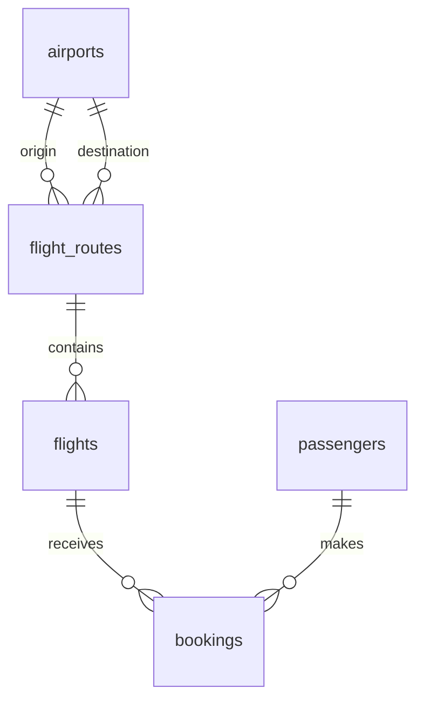

# Airline Booking System

Demo Video: https://drive.google.com/file/d/1q1K-22WdpUkO8PFG7GWYybZ1wJVVnGqf/view?usp=drive_link

SQL analytics project for Boston University EX603 — Data & Algorithms for Scalable Systems, using PostgreSQL to analyze airline bookings, fare patterns, and booking reliability.

## 1. Project Domain

The Airline Booking System connects passengers, flights, routes, and airports. The analytical objective is to help airline management understand booking demand, compare flight performance, identify problematic booking outcomes, and monitor changes over time.

The project progresses from relational queries and grouped reporting to window functions that preserve individual booking records while adding rankings, comparisons, and time-based metrics. The final analysis supports decisions about cancellations, disputes, pricing, and performance monitoring.

| Analytical component | Definition |
|---|---|
| Producer | `flight_id` |
| Event | Individual booking |
| Metric | `fare_paid` |
| Timestamp | `booked_at` |
| Failure | `booking_status IN ('cancelled', 'disputed')` |

## 2. Database Overview

The schema and DDL were provided in Unit 3. The project uses the `ex603_data` database.

### Entity Relationship Diagram



This relationship diagram summarizes the supplied schema. The original Unit 3 ERD and DDL should also be retained in the repository.

### Schema

The Airline Booking System database contains five main tables:

-   **airports** -- Stores airport information such as airport name,
    airport code, city, and country.
-   **passengers** -- Stores passenger information including first name,
    last name, and email address.
-   **flight_routes** -- Defines routes between an origin airport and a
    destination airport.
-   **flights** -- Stores individual flights, including the route,
    departure and arrival times, seating capacity, and available seats.
-   **bookings** -- Connects passengers to flights and stores booking
    information such as booking date and fare paid.

### Design Decisions

The tables are connected using foreign keys to maintain relationships
between the data. A flight route must reference valid origin and
destination airports, a flight must reference an existing flight route,
and a booking must reference both an existing passenger and an existing
flight.

`ON DELETE RESTRICT` is used on the foreign keys so that records that
are still being used cannot be deleted. For example, an airport cannot
be deleted if a flight route references it, and a passenger or flight
cannot be deleted if there are existing bookings.

The schema also uses `CHECK` constraints to prevent invalid data. The
origin and destination airports cannot be the same, the arrival time
must be later than the departure time, seating capacity must be greater
than zero, available seats cannot be negative or greater than the
seating capacity, and the fare paid cannot be negative.

Unique constraints are used for values that should not be duplicated.
Airport codes are unique because each airport should have its own code,
and passenger email addresses are unique to prevent duplicate passenger
accounts.

## 3. Query Catalogue

### Units 1–3: Foundations and Relational Queries

The earlier units establish the project context and the supplied relational database. Unit 3 uses SQL filtering, joins and subqueries to retrieve booking information. See the [query directory](queries/) for the earlier scripts.

### Unit 4: Aggregation and Reporting — Query Catalogue

| Task | Query | Business Question |
|---|---|---|
| 4.1.1 | Overall Booking Statistics | What are the total bookings, total fare paid, average fare, minimum and maximum fares, and number of unique passengers? |
| 4.1.2 | Per-Flight Aggregation | Which flights have the highest booking volumes, and how do their average fares compare? |
| 4.1.3 | High-Volume Flights | Which flights have booking volumes at or above the average bookings per flight? |
| 4.1.4 | Regional Booking Breakdown | How do booking volumes and statuses vary across countries? |
| 4.2 Part A | Conditional Aggregation | How many bookings and failed bookings does each flight have? |
| 4.2 Part B | Regional Subtotals and Grand Total | How much recorded fare amounts does each country generate, and what is the total platform fare amount? |
| 4.2 Part C | Two-Step CTE Pipeline | Which flights meet the booking-volume threshold, and how do their failure rates compare with the overall baseline? |


### Unit 5: Query Analysis and Optimization

The earlier query-analysis work examines join strategies, indexing and query execution costs. See the [query directory](queries/) for the original scripts.

### Unit 6: Window Functions and Analytical Reporting

| Task | SQL file | Business question |
|---|---|---|
| 6.1.1 | [q6_1.sql](queries/unit6/q6_1.sql) | How does each booking fare compare with its flight average, and how does the result differ from GROUP BY? |
| 6.1.2 | [q6_1.sql](queries/unit6/q6_1.sql) | How do ROW_NUMBER, RANK and DENSE_RANK handle tied booking counts? |
| 6.1.3 | [q6_1.sql](queries/unit6/q6_1.sql) | How can flights be divided into four booking-volume bands, and can ties cross band boundaries? |
| 6.2 A | [q6_2.sql](queries/unit6/q6_2.sql) | How do consecutive booking fares change for the same flight? |
| 6.2 B | [q6_2.sql](queries/unit6/q6_2.sql) | How do cumulative fares and a seven-booking moving average evolve relative to a hypothetical $1,000 quarterly target? |
| 6.2 C | [q6_2.sql](queries/unit6/q6_2.sql) | Which flights have gaps greater than seven days between bookings? |
| 6.3 A | [q6_3.sql](queries/unit6/q6_3.sql) | What are the three highest-paying bookings for each flight? |
| 6.3 B | [q6_3.sql](queries/unit6/q6_3.sql) | How do monthly booking volumes, fare amounts and failure rates change? |
| 6.4 | [Leadership memo](analysis/unit6-finding.md) | Is booking reliability improving, and what should management do next quarter? |

Additional documentation: [Unit 6 write-up and reflection](analysis/unit6.md).

## 4. Technical Highlights

- **Joins and subqueries:** Retrieve related booking, flight and passenger information and compare records against calculated thresholds.
- **Aggregation and conditional aggregation:** Use GROUP BY, COUNT, SUM and CASE to calculate booking volumes, fare statistics and failure rates.
- **CTEs:** Separate aggregation, ranking and filtering into readable stages, including platform baseline comparisons.
- **Window functions:** Use partitioned averages, ROW_NUMBER, RANK, DENSE_RANK, NTILE, LAG, LEAD and FIRST_VALUE to retain analytical detail while comparing related records.
- **Time-series reporting:** Use explicit ROWS frames for running totals and moving averages, DATE_TRUNC for monthly reporting, NULLIF to prevent division by zero, and calendar checks to avoid misleading comparisons across missing months.

## 5. Findings and Recommendations

### Booking reliability

The booking-status validation returned 200 bookings: 156 confirmed, 34 cancelled and 10 disputed. Under the revised failure definition, 44 bookings are failures, yielding a baseline of **22%**. Cancellations account for 77.27% of failures. Management should prioritize cancellation reasons and investigate flights with high failure counts and sufficient booking volume.

The earlier no-show condition did not match the recorded statuses. Earlier failure queries should be updated and rerun using the revised definition. The direction of the monthly failure trend remains pending the corrected Task 6.3 B output.

### Booking demand and fare changes

The monthly booking report shows that bookings declined from 21 in February 2023 to 11 in March (47.62%), while recorded fares fell from $453.44 to $135.98 (70.01%). In April, booking volume remained at 11 but recorded fares rose to $259.75 (91.02%). Management should investigate demand, pricing and booking mix rather than relying on booking volume alone.

### Next-quarter priorities

Monitor monthly cancellation and dispute rates, investigate high-failure flights, and evaluate a proposed reduction in the failure rate from 22% to 18%. Track results using the monthly reporting query. The target is a proposed business goal, not an observed outcome.

## 6. Limitations and Future Improvements

The dataset contains only 200 bookings covering 2023, limiting conclusions about seasonality and long-term trends. Cancellation and dispute reasons are not available in the analyzed records, and total fare paid is not necessarily realized revenue because refunds may apply. Booking gaps alone cannot establish whether demand stopped or records were missing.

Future work should incorporate additional years of bookings, cancellation reasons, refund records, flight availability and data ingestion logs.

## 7. Video Presentation

**Presentation link:** [Add public or accessible unlisted video URL before submission.]

The 3–5 minute presentation will demonstrate representative SQL queries, including a Unit 6 window function, explain the findings and recommendations, and discuss analytical limitations.

## 8. How to Run the Project

Prerequisites: PostgreSQL and the Unit 3 schema and dataset. Run the following from the repository root after loading the supplied DDL and data according to the Unit 3 instructions.

```bash
# Create the database if it does not already exist
createdb ex603_data

# Replace the placeholder with the actual supplied DDL path
psql -d ex603_data -v ON_ERROR_STOP=1 -f <path-to-unit3-ddl.sql>

# Load the supplied Unit 3 dataset using its original instructions
# Then execute the analytical queries
psql -d ex603_data -v ON_ERROR_STOP=1 -f queries/unit6/q6_1.sql
psql -d ex603_data -v ON_ERROR_STOP=1 -f queries/unit6/q6_2.sql
psql -d ex603_data -v ON_ERROR_STOP=1 -f queries/unit6/q6_3.sql
```

The queries can also be executed individually in pgAdmin. Query screenshots belong in `screenshots/`.

## 9. Repository Organization

```text
README.md
queries/
  unit6/
    q6_1.sql
    q6_2.sql
    q6_3.sql
analysis/
  unit6.md
  unit6-finding.md
screenshots/
```

Earlier unit files and the supplied Unit 3 schema artifacts should remain in the repository. Do not publish credentials, connection strings or personal passenger data.
